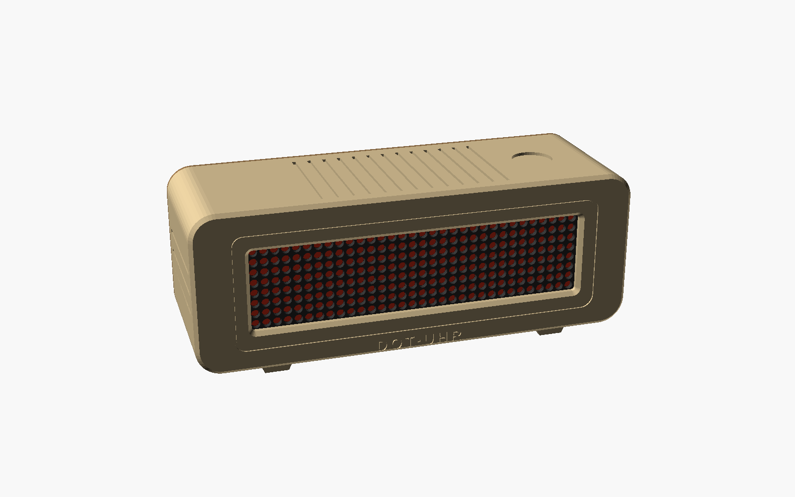
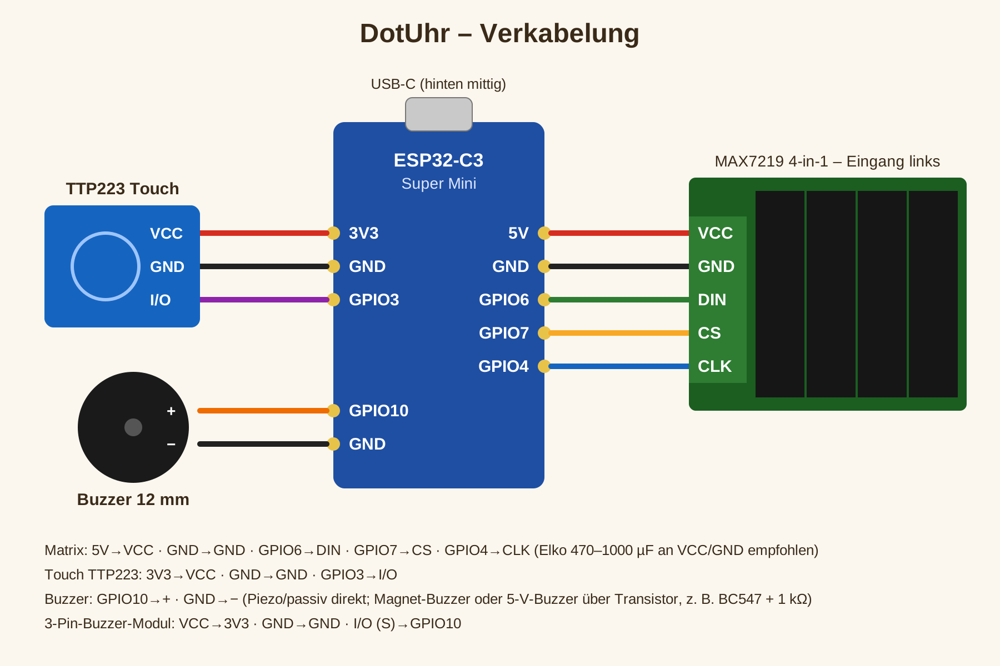
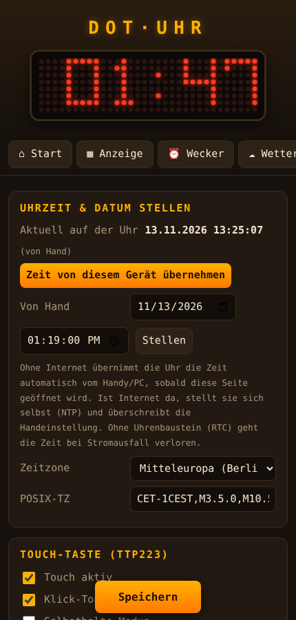
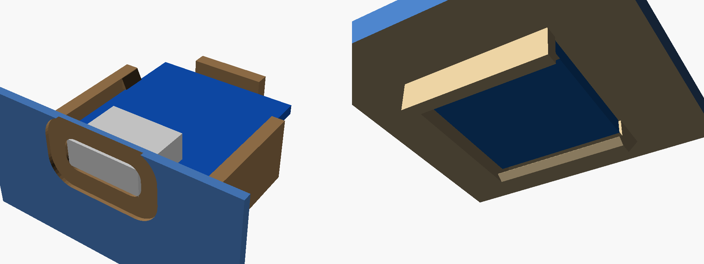

# DotUhr – Retro-Punktmatrix-Uhr mit ESP32-C3 Super Mini + MAX7219



**Download:** [Releases](../../releases/latest) (Firmware + STL) · Ordner [`firmware/bin/`](firmware/bin/) · [`gehaeuse/stl/`](gehaeuse/stl/)

Uhr · Wecker · Datum · Wetter · Laufschrift · Touch-Taste · Web-Oberfläche · 3D-Druck-Gehäuse (USB-C hinten mittig)

```
DotUhr/
├─ firmware/DotUhr/        Arduino-Sketch (DotUhr.ino, DotUhr_main.cpp, webui.h)
├─ firmware/bin/           fertige Firmware (Komplett-Image + OTA-Update)
├─ gehaeuse/               OpenSCAD-Quelle (parametrisch) + STL-Dateien
├─ bilder/                 Verkabelung, Renderings, Anzeige-Vorschau
└─ verkabelung.svg
```

---

## 1. Verkabelung

| MAX7219 (Eingang, linke Seite) | ESP32-C3 Super Mini |
|---|---|
| VCC | **5V** |
| GND | **GND** |
| DIN | **GPIO 6** |
| CS  | **GPIO 7** |
| CLK | **GPIO 4** |

| TTP223 Touch | ESP32-C3 |
|---|---|
| VCC | **3V3** |
| GND | GND |
| I/O | **GPIO 3** |

| Buzzer | ESP32-C3 |
|---|---|
| + (bzw. I/O / S beim 3-Pin-Modul) | **GPIO 10** |
| − | GND |
| VCC (nur 3-Pin-Modul) | 3V3 |

* **Buzzer-Typ:** Ein *passiver* Buzzer bzw. Piezo spielt Töne und Melodien und wird direkt angeschlossen. Ein *aktiver* Buzzer piept von selbst, sobald Spannung anliegt, und kann nur an/aus. Den Typ wählst du in der Web-Oberfläche. Magnet-Buzzer oder 5-V-Buzzer nicht direkt am Pin betreiben, sondern über einen Transistor (z. B. BC547 mit 1 kΩ an der Basis).
* **TTP223 (Platine 14 × 14 mm, mit Winkel-Stiftleiste 19 mm lang):** Das Modul erkennt Berührungen durch bis zu ca. 5 mm Kunststoff, die 2 mm Restwand der Gehäuse-Mulde sind also unkritisch. Die **glatte Rückseite** (ohne Bauteile) kommt nach oben an die Wand; Chip und Stiftleiste zeigen nach unten, die Stifte nach innen.
* **Modus:** Das Modul kann „Punkt“ (Ausgang an, solange man berührt) oder „selbsthemmend“ (jede Berührung schaltet um). Ab Werk ist es auf **Punkt** eingestellt (Lötbrücken offen), und das ist ideal. Falls es auf selbsthemmend umgelötet ist: in der Web-Oberfläche *Selbsthalte-Modus* aktivieren. Dann gilt **2× schnell tippen** statt halten.
* **Prüfen:** In der Web-Oberfläche erscheint „● berührt“. Im Punkt-Modus sollte das nur so lange zu sehen sein, wie der Finger aufliegt.



* GPIO 2, 8 und 9 bleiben frei (Boot-Pins bzw. Onboard-LED). Wer andere Pins will, ändert sie oben in `DotUhr_main.cpp`.
* **Elko 470–1000 µF / ≥10 V** direkt an VCC/GND des Moduls. Das ist optional, macht die Anzeige aber stabiler.
* **Stromverbrauch:** Bei der Uhrzeit mit geringer Helligkeit sind es etwa 50–150 mA. Wenn alle LEDs auf voller Helligkeit leuchten, kann ein 4-in-1-Modul über 1 A ziehen. Nimm deshalb ein USB-Netzteil mit mindestens 2 A und lass die Helligkeit eher niedrig (der Standardwert 3 von 15 ist hell genug).
* **3,3-V-Logik:** Der MAX7219 läuft mit 5 V, der ESP32-C3 liefert aber nur 3,3 V an den Datenleitungen. Das funktioniert praktisch fast immer. Zeigt das Display trotzdem Müll, gibt es zwei Lösungen:
  (a) eine Diode (1N4001/1N5817) in die VCC-Leitung setzen, damit das Modul etwa 4,3–4,6 V bekommt, oder
  (b) einen Pegelwandler (z. B. 74HCT125) verwenden.
* **Mehrere Module:** Ausgang (rechts) → Eingang des nächsten Moduls. Die Anzahl stellst du in der Web-Oberfläche ein.

> Hinweis zum Modul: Laut Datenblatt ist es 13,2 × 3,2 cm groß. Das ist das übliche **4-in-1-Modul (32 × 8 Pixel, „FC16“)**, und darauf sind Firmware und Gehäuse ausgelegt.

---

## 2. Firmware aufspielen

### Variante A – ohne Arduino IDE (fertige Datei)
1. Den ESP32-C3 per USB-C anschließen.
2. In Chrome oder Edge den Web-Flasher **https://espressif.github.io/esptool-js/** öffnen und auf *Connect* klicken.
   Falls kein Port erscheint: die **BOOT**-Taste gedrückt halten, kurz **RST** drücken und BOOT dann loslassen.
3. Die Datei `firmware/bin/DotUhr_komplett_0x0.bin` an Adresse **0x0** flashen und danach RST drücken.

### Variante B – Arduino IDE
1. Boardverwalter: **esp32 von Espressif** installieren (getestet ist Core 2.0.x; 3.x sollte auch gehen).
2. Bibliotheken: **MD_Parola**, **MD_MAX72XX** (majicDesigns) und **ArduinoJson** (Version 7).
3. Unter *Werkzeuge* einstellen:
   * Board: **ESP32C3 Dev Module**
   * USB CDC On Boot: **Enabled**
   * Flash Size: **4MB**
   * Partition Scheme: **Minimal SPIFFS (1.9MB APP with OTA)** (Default 4MB geht auch)
   * Flash Mode: **DIO**, falls das Board nach dem Hochladen nicht startet
4. `firmware/DotUhr/DotUhr.ino` öffnen und hochladen. Der eigentliche Code steht in `DotUhr_main.cpp` im selben Ordner.

**Spätere Updates** gehen ohne Kabel über die Web-Oberfläche (*System → Firmware-Update*). Dafür nimmst du `DotUhr_update_OTA.bin` oder in der IDE *Sketch → Kompilierte Binärdatei exportieren*.

---

## 3. Ersteinrichtung

1. Nach dem Einschalten läuft die Laufschrift: `WLAN "DotUhr-Setup" verbinden -> http://192.168.4.1`
2. Verbinde das Handy mit diesem WLAN. Es ist offen, du brauchst also **kein Passwort**. Die Einstellungsseite öffnet sich normalerweise von selbst, sonst http://192.168.4.1 aufrufen.
3. Unter **WLAN** auf *Suchen* tippen, dein Netz auswählen, das Passwort eingeben und auf **Speichern** tippen. Die Uhr startet dann neu.
4. Danach zeigt die Uhr ihre IP-Adresse an. Die Oberfläche erreichst du dann unter **http://dotuhr.local** oder unter der angezeigten IP.
5. Unter **Wetter** deinen Ort suchen, auswählen und speichern.

Die Daten kommen von Open-Meteo. Das ist kostenlos und braucht keinen API-Schlüssel.

## 4. Web-Oberfläche



Die Oberfläche ist in Reiter aufgeteilt: **Start** (Status, Sofort-Nachricht) · **Anzeige** (Ablauf, Uhr & Datum, Helligkeit) · **Wecker** · **Wetter** · **System** (Uhrzeit stellen, Zeitzone, Touch, WLAN, Update).

* **Live-Vorschau** der Matrix oben auf der Seite
* **Status:** Zeit, Datum, Wetter, IP, WLAN-Signal, Laufzeit
* **Sofort-Nachricht** mit einstellbarer Anzahl an Wiederholungen
* **Ablauf:** Uhr, Datum, Wettersymbol, Wetter-Laufschrift und eigene Laufschrift einzeln an/aus, jeweils mit eigener Anzeigedauer und Scroll-Tempo
* **Uhr-Stile:** `HH:MM`, `HH:MM` mit Sekundenbalken, `HH:MM:SS` klein; 12/24 h; blinkender Doppelpunkt
* **Ziffern-Stile:** Klassik oder Rund (LCD)
* **Wecker:** 3 Weckzeiten mit Wochentagen (ohne Wochentag = einmalig), 3 Töne (Piepen, Melodie, Klingel), Schlummerzeit, maximale Klingeldauer, Test-Knopf. Beim Klingeln blinkt die Uhr invertiert, auch wenn die Anzeige nachts aus ist. Ein aktiver Wecker zeigt einen Punkt oben rechts; beim Schlummern blinkt er.
* **Touch-Taste (TTP223):**
  | Aktion | normal | Wecker klingelt |
  |---|---|---|
  | kurz tippen | nächste Anzeige (nachts: Anzeige 15 s an) | Schlummern |
  | 1,5 s halten | Anzeige an/aus | Wecker aus |
* **Datum:** `12.11.`, `Do 12.11.` oder `Donnerstag, 12. November 2026`
* **Helligkeit + Nachtmodus:** Die Regler wirken sofort und werden automatisch gespeichert. Nachts kann die Uhr dimmen oder ganz ausgehen.
* **Uhrzeit & Datum ohne Internet:** Unter *System* kannst du die Zeit mit einem Knopf vom Handy/PC übernehmen oder Datum und Uhrzeit von Hand eintragen. Ist die Uhr noch nicht gestellt, übernimmt sie die Zeit automatisch, sobald du die Seite öffnest (praktisch im Einrichtungs-WLAN ohne Internet). Ist Internet da, stellt sie sich selbst über NTP. Ohne Uhrenbaustein (RTC) geht die Zeit bei Stromausfall verloren.
* **System:** Zeitzone, Matrix-Typ, Anzahl der Module, Gerätename, OTA-Update, Neustart, Werkseinstellungen

Umlaute, ß und ° werden korrekt dargestellt.

**HTTP-API** (z. B. für Home Assistant oder Node-RED):
```
GET  /api/message?text=Waschmaschine%20fertig&repeat=3
GET  /api/brightness?v=0..15&save=1
GET  /api/alarm?action=test|snooze|stop
GET  /api/time?epoch=1763036400            (Sekunden seit 1970, UTC)
GET  /api/time?local=2026-11-13T13:20:00   (Ortszeit)
GET  /api/status        JSON mit Zeit, Wetter, WLAN …
GET  /api/config        Einstellungen ohne Passwort
POST /api/config        JSON mit den Feldern, die geändert werden sollen
```

---

## 5. Gehäuse drucken

Maße außen: **170 × 62 × 60 mm** (B × H × T). Der USB-C-Anschluss sitzt **hinten mittig** in einer Tasche für den Stecker.

| Datei | Ausrichtung | Hinweis |
|---|---|---|
| `dotuhr_body.stl` | Front nach unten (liegt schon so) | **ohne Stützmaterial**, 3 Wände, 15–20 % Infill |
| `dotuhr_cover.stl` | Außenseite nach unten | ohne Stützmaterial |
| `dotuhr_grid.stl` | flach | **Pixelgitter**, schwarz drucken; macht die Punkte rund und scharf |
| `dotuhr_diffuser.stl` | flach | **Streuscheibe** 0,8 mm (2–4 Lagen), weiß/transparentes PETG oder grau |

Die Gravur „DOT·UHR“ vorne und „USB-C 5V“ hinten wird direkt in den ersten Schichten mitgedruckt. Mit einem Filamentwechsel in Schicht 2–3 bekommst du eine zweifarbige Schrift.
Statt der gedruckten Streuscheibe kannst du auch **getöntes Acryl (Rauchglas) 132 × 32 mm, 1–2 mm** einsetzen. Das sieht besonders retro aus.

Retro-Tipp: Gehäuse in Creme/Beige drucken, Deckel in Braun, Gitter in Schwarz und als Streuscheibe rotes Transparent-PETG verwenden.

### Zusammenbau
1. Von hinten in die Displaytasche einlegen: Streuscheibe → Pixelgitter → Matrix-Modul (LEDs nach vorne, **Eingang links** von vorne gesehen).
2. **Touch-Sensor:** Von innen seitlich in die Schiene unter der Mulde (oben rechts) schieben, bis er am Anschlag anliegt. Die glatte Seite zeigt nach oben an die Wand, Bauteile und Stiftleiste zeigen nach unten, die Stiftleiste zur Gehäusemitte. Die Schiene hält ihn ohne Kleber.
3. **Buzzer** in den Ring im Deckel (über der USB-Buchse) einkleben, Öffnung zu den Schalllöchern.
4. **ESP32-C3:** Die USB-Buchse schräg in den Durchbruch im Deckel stecken. Dann die Platine flach auf die Auflage drücken, bis die beiden federnden Wangen mit ihren Rastnasen über die Platinenkante **einklicken**. Der Anschlag am hinteren Ende fängt den Druck beim Einstecken des Kabels ab. Zum Ausbauen die Wangen leicht auseinanderbiegen.

   
   *Links: ESP32-C3-Halter im Deckel (Wangen mit Rastnasen, Anschlag hinten). Rechts: Touch-Schiene von unten.*
5. Die Kabel anschließen. Sind an das ESP-Board Stiftleisten gelötet, sollten sie **nach unten** zeigen. Noch flacher wird es, wenn du die Kabel direkt anlötest.
6. Den Deckel aufsetzen. Die 4 Stützen halten das Modul in der Tasche (4 mm Luft; bei Bedarf Moosgummi unterlegen).
   Mit **4 × M3 × 8–10 Senkkopf**-Schrauben (selbstschneidend in 2,6 mm) festschrauben.

### Anpassen (OpenSCAD)
`gehaeuse/dotuhr_gehaeuse.scad` öffnen; im Customizer sind alle Maße einstellbar. Die wichtigsten Parameter:
* `mod_pcb_back`: **bitte nachmessen!** Gemeint ist der Abstand von der Vorderseite der Matrix bis zur Rückseite der Platine (Standard 10 mm). Davon hängt die Länge der Andruck-Stützen ab. Sitzt das Modul locker, den Wert etwas kleiner machen oder ein Stück Moosgummi dazwischenlegen.
* `esp_pcb_t`: Platinenstärke des Super Mini (je nach Charge 1,0–1,6 mm). Davon hängt die Höhe der Rastnasen ab.
* `esp_snap`: Überstand der Rastnasen (Standard 0,8 mm). Kleiner machen, wenn sie an Lötstellen stoßen.
* `use_grid`, `dif_t`: ohne Gitter bzw. ohne Streuscheibe
* `cable_slot`: Kabelschlitz (Standard 20 mm) links und rechts mittig in der Displaytasche, bis zur Frontwand – Platz für die Dupont-Stecker an Ein- und Ausgang des Moduls
* `post_short`: Die Andruck-Stützen im Deckel sind um diesen Wert gekürzt (Standard 4 mm)
* `label`: eigener Schriftzug vorne
* `touch`, `touch_x`, `touch_w`, `touch_l`, `touch_wall`: Touch-Mulde (Standard: 14 × 14 mm wie das TTP223-Punkt-Modul); `touch_pcb` = Platinenstärke für den Schienenschlitz
* `buzzer`, `buz_d`: Buzzer-Halter (Standard 12 mm)
* `screw_core = 4.0`: für Gewindeeinsätze M3 statt selbstschneidender Schrauben

Export: `openscad -D 'part="body"' -o body.stl dotuhr_gehaeuse.scad` (Teile: `body`, `cover`, `grid`, `diffuser`, `print_all`)

---

## 6. Fehlersuche

| Problem | Lösung |
|---|---|
| Text gespiegelt, verdreht oder in Blöcken vertauscht | *System → Matrix-Typ* ändern (FC16 / GENERIC / PAROLA / ICSTATION) |
| Nur ein Block zeigt etwas an | *Anzahl 8×8-Module* auf 4 stellen |
| Wirre Pixel / flackert | Elko nachrüsten, Kabel kürzen, Diode in VCC (siehe 3,3-V-Logik) |
| WLAN verbindet nicht / bricht ab | *Sendeleistung reduzieren* aktiv lassen (bekanntes Antennenproblem beim Super Mini), 2,4-GHz-Netz verwenden |
| Uhr zeigt `--:--` | Kein Internet: Web-Oberfläche öffnen (stellt die Zeit automatisch) oder unter *System → Uhrzeit & Datum stellen* |
| Kein serieller Monitor | In der IDE *USB CDC On Boot: Enabled* einstellen |
| Touch reagiert nicht | Statusanzeige „● berührt“ in der Web-Oberfläche prüfen; Sensor fest an die Wand drücken; ggf. *Signal invertieren* |
| Buzzer leise/stumm | Buzzer-Typ (passiv/aktiv) in der Web-Oberfläche richtig wählen |
| Alles zurücksetzen | Web-Oberfläche → *Werkseinstellungen* |
